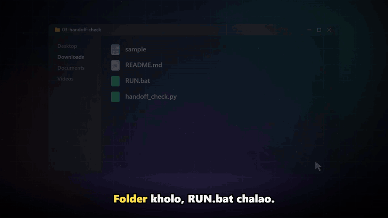

# Handoff Check



Thumbnail ne viewer se ek vaada kiya. Video ka pehla frame use nibhata hai ya nahi? Ye tool dono ko compare karke 100 mein se score deta hai.

Sab kuch tumhare PC pe chalta hai. Koi account nahi, koi API key nahi, kuch upload nahi hota.

## Chalane ka tareeka

### 1. Python install karo (sirf pehli baar)
1. [python.org/downloads](https://www.python.org/downloads/) kholo aur Python download karo.
2. Installer ki pehli screen pe **Add python.exe to PATH** pe tick lagao.
3. **Install Now** dabao.

### 2. Tool download karo
1. Is repo ke main page pe hare **Code** button pe click karo, phir **Download ZIP**.
2. ZIP pe right click karke **Extract All** karo.
3. Andar `03-handoff-check` folder kholo.

### 3. Chalao
1. **RUN.bat** pe double click karo. Pehli baar zaroori cheezein apne aap install hongi, 1-2 minute lagenge.
2. Apna thumbnail window mein kheench ke chhodo, **Enter** dabao.
3. Apni video kheench ke chhodo, **Enter** dabao.
4. Score aa jayega, aur dono pictures ke saath `handoff_report.png` khul jayegi.

Pehle dekhna ho ki kaisa chalta hai? Dono jagah khali chhod ke Enter dabao, tool `sample` folder pe chalega.

## Score ka matlab

| Score | Matlab | Kya karo |
|---|---|---|
| 80 ya upar | PASS: vaada nibha | Kuch mat badlo |
| 50 se 79 | WEAK: thoda hi match hai | Thumbnail ka main object pehle frame mein lao |
| 50 se neeche | FAIL: viewer ko alag video dikhegi | Pehla frame thumbnail jaisa banao, phir dobara chalao |

Tool do cheezein dekhta hai: **Color match** (rang wahi hain?) aur **Layout match** (roshni aur andhera usi jagah hain?). Score in dono ka average hai. Ye sirf picture ka match batata hai, video kitni acchi hai ye nahi.

## Sample pe asli result

```
python handoff_check.py sample\thumb.png sample\video_before.mp4
Color match   23/100
Layout match  10/100
HANDOFF SCORE 17/100
Verdict: FAIL, viewers see a different video

python handoff_check.py sample\thumb.png sample\video_after.mp4
Color match   86/100
Layout match  81/100
HANDOFF SCORE 83/100
Verdict: PASS, the promise carries over
```

## Dikkat aaye to

| Kya dikha | Kya karo |
|---|---|
| `Python nahi mila` | Python install karo, **Add python.exe to PATH** pe tick lagake. Phir RUN.bat dobara chalao. |
| Microsoft Store khul gaya | Python abhi install nahi hai. Upar wala step 1 karo. |
| `Install nahi ho paya` | Internet check karo, RUN.bat dobara chalao. |
| `File not found` | Path galat hai. File ko type mat karo, window mein kheench ke chhodo. |
| `Could not read the video` | Video kharab hai ya format ajeeb hai. MP4 export karke try karo. |
| Windows "protected your PC" bole | **More info**, phir **Run anyway**. Code khud padh sakte ho, `RUN.bat` aur `handoff_check.py` khule hain. |

## Command line se

```
pip install pillow numpy imageio-ffmpeg
python handoff_check.py thumb.png video.mp4 --out report.png
```
