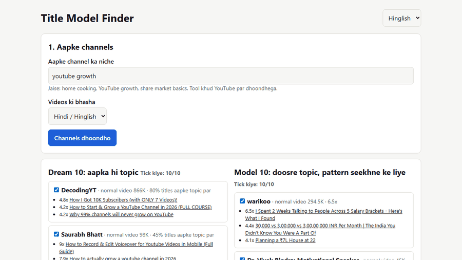

# Title Model Finder



Don't copy titles from your own niche. Type your niche, and this tool finds channels, shows which of their videos beat their own normal, and writes a title and thumbnail prompt for each video you make.

Everything runs on your own PC, and it's free. No account and no cookies. A free Gemini key is optional.

It does **not** predict views, score your title or pick a winning thumbnail. Nobody can know that before viewers see it.

## Quick start

### 1. Install Python (first time only)
1. Go to [python.org/downloads](https://www.python.org/downloads/) and download Python.
2. On the first installer screen, tick **Add python.exe to PATH**.
3. Click **Install Now**.

### 2. Download the tool
1. On the main page of this repo, click the green **Code** button, then **Download ZIP**.
2. Right-click the ZIP and choose **Extract All**.
3. Open the `04-title-model-finder` folder.

### 3. Run it
1. Double-click **RUN.bat**. The first run installs what it needs, which takes about a minute. A page opens in your browser. Keep the black window open while you use it.
2. Choose English or Hinglish at the top. Type your niche, choose your videos' language, and click **Find channels**. This takes about a minute.
3. Tick up to 10 channels in **Dream 10** and up to 10 in **Model 10**, then click **Save my lists**. The tool remembers them. It won't ask again unless you click **Change channels**.
4. For each video, type its title and paste its description or SRT, or choose the file. Click **Make my prompt**.
5. Copy the prompt into any AI chat, such as ChatGPT, Claude or Gemini. You get titles, thumbnail text and image prompts for that video. The prompt is also saved in the `prompts` folder, under your video's title.

## Which channels to tick

- **Dream 10:** channels on your own topic. They show what your viewer likes.
- **Model 10:** channels on other topics, found in crowded niches such as finance, fitness and business. Keep the ones that make videos the way you do: faceless with faceless, on-camera with on-camera.

The list comes from real YouTube search, so read the sample titles and untick anything off-topic. To add a channel the search missed, put its link in the box under the lists.

## Thumbnails, all free

- **Draw it on your PC:** type the thumbnail text and click **Draw**. You get big plain letters as a 1280x720 JPG in `thumbnails_made`. Use roman letters, because this can't write Devanagari correctly.
- **Use a free image tool:** paste the image prompt from your AI chat into [gemini.google.com](https://gemini.google.com) or another image tool.
- **Check thumbnails you already have:** put them in the `thumbnails` folder and run RUN.bat again, then click **Check them with this title**.

## Optional: a free Gemini key

With a key, the page can write titles itself instead of you pasting the prompt, and it can look for more channels if search finds too few.

1. Get a free key at [aistudio.google.com/apikey](https://aistudio.google.com/apikey).
2. Paste it under **Optional: free Gemini key**. It stays in `gemini_key.txt` on your PC.

Two things to know:
- Google's free tier often allows no image generation, so **Try Gemini image** may only give you a limit message. Use the other thumbnail options then.
- If your Google project has billing on, Google can charge for what you use. For a free key, keep billing off.

## What you get

**`report.html`**
- **Your title:** the facts about the title you typed, if you typed one.
- **Frameworks that repeat across channels:** the patterns found in the outliers of 2 or more channels, widest first.
- **Channel by channel:** each channel's normal video and its top outliers, with thumbnail, title, views and link.

**`prompt.txt`**
Paste it into any AI chat and fill in the top: what your video really shows, the proof you have, your viewer and your language. The AI then writes titles for that video on the patterns that fit it. Fill in the video itself, not only your channel's topic, or the titles come out generic. Check every title yourself, because AI chats can still make things up.

## How to read the numbers

**6.5x** means the video got 6.5 times the channel's median views. The median is that channel's normal video, taken from up to 60 recent long videos. Shorts are not counted.

A video needs at least 2x to count as an outlier. Each channel shows its top 5.

The framework is a guess from word rules:

| Framework | Looks for |
|---|---|
| I thought X, but Y | "I thought", "mujhe laga" |
| I did X, here is what happened | "I spent", "I tried", "maine" |
| Hard thing in N minutes | "in 10 mins", "10 minute mein" |
| N things / mistakes | "5 mistakes", "Top 10 tips" |
| X vs Y | "vs" |
| Best X | "best", "sabse accha" |
| How to X | "how to", "kaise" |
| Why X | "why", "kyun" |

If nothing matches, it says **Other** and never forces a label. Read those titles yourself, because good patterns often sit there. A video also wins on its topic, so one hit can be chance. Trust a pattern when it repeats across channels.

## What the title check tells you

- **Length:** the 45-55 character rule comes from English titles, and search titles can run a little longer. For Hindi it is only a note, so test it on your own channel.
- **"and", "aur", "&":** this often means two promises. Keep one.
- **Trigger words:** curiosity, desire and fear words found, from separate English, Hinglish and Hindi lists. It shows what is in the title, not whether the title is good.

## What the thumbnail check tells you

Each title and thumbnail pair is shown at about the size a viewer sees it, with these facts:

- **Repeats or adds:** which big words on the thumbnail are already in the title, and which are new. A thumbnail that repeats the title says the same thing twice, though sometimes the idea is big enough to repeat.
- **Big words:** how many words the eye has to read.
- **Clear, small or lost at feed size:** based on how tall each line of text is. Under 8% of the thumbnail's height is small, and under 5% is lost.
- **Low contrast:** text that blends into what is behind it.

The tool doesn't pick a winner. Use these facts to choose your best 2-3 pairs, then let **Test & Compare** in YouTube Studio decide.

The text reader runs on your PC and can misread stylised letters, such as ITR-1 as LTR-1. It does not read Devanagari, so Hindi text in Devanagari shows up as no text. Compare what it read with your picture.

`prompt.txt` also asks the AI for 2 thumbnail ideas for each title it wants you to test. Its text has to add what the title holds back.

## Real results from the sample (shortened)

```
python title_model_finder.py channels.txt --title "Best Tips and Tricks to Grow Your YouTube Channel Fast"

warikoo: normal 294.5K, 60 videos
  6.5x  I Spent 2 Weeks Talking to People Across 5 Salary Brackets - Here's What I Found
Labour Law Advisor: normal 317.5K, 42 videos
  5.7x  National Pension System | NPS vs PPF vs MFs | Ultimate Guide
CA Rachana Phadke Ranade: normal 51K, 51 videos
  7.9x  Jio Platforms Ltd. | Key Things You Need to Know | CA Rachana Ranade

Frameworks in 2+ channels: Why X (4), I did X, here is what happened (2), N things / mistakes (2), X vs Y (2)

Title: Best Tips and Tricks to Grow Your YouTube Channel Fast
  Length: 54 characters: inside 45-55
  Joined with and: this may be two promises. Keep one.
  Curiosity -
  Desire    best, fast, grow
  Fear      -

thumb_A_repeats.png + Tags Se Views Kyun Nahi Badhte
  Mostly repeats the title (tags, views, kyun, nahi). This says the same thing twice.
  Big words: 4
  Clear at feed size: TAGS SE VIEWS, KYUN NAHI?

thumb_B_adds.png + Tags Se Views Kyun Nahi Badhte
  Adds to the title. New words: bekaar, mehnat.
  Big words: 2
  Clear at feed size: BEKAAR, MEHNAT?
```

These numbers are from 6 November 2026. Your run will differ, because views keep moving.

## Limits

- View counts come rounded from YouTube's list, such as 1.9M, so the x is close but not exact.
- New videos are still collecting views, so they can look weaker than they will be.
- Under 15 videos, the report marks the channel as **Thin data**, because its median can't be trusted much.

## Troubleshooting

| What you see | What to do |
|---|---|
| `Python was not found` | Install Python with **Add python.exe to PATH** ticked, then run RUN.bat again. |
| The Microsoft Store opens | Python is not installed yet. Follow step 1 above. |
| `Setup failed` | Check your internet connection and run RUN.bat again. |
| The page didn't open | Copy the link shown in the black window into your browser. |
| `Fewer than 10 usable channels` | Write a wider niche, or add channels yourself in the box under the lists. |
| `Google refused this key` | Check the key at aistudio.google.com/apikey. |
| `Google's free limit said no` | Your key has no quota for this, or you need to wait. Paste the prompt into a chat instead. |
| `channel not found, check the handle` | Open the channel on YouTube and copy its link from the address bar into the box under the lists. |
| `this channel has no Videos tab` | The channel has only Shorts or live streams, or the handle belongs to a different channel. Use another channel or check the link. |
| `Skipped, not a channel link` | That line is a video or a playlist. Open the channel page and copy that link. |
| `YouTube blocked the request` | Wait a while and try again. |
| `No channel could be read` | Check your internet, then update the reader: `python -m pip install -U yt-dlp` |
| `The thumbnail check needs one more install` | Run `python -m pip install rapidocr-onnxruntime pillow`, or run RUN.bat again. |
| `No big text found` on a thumbnail with text | The text may be in Devanagari or very stylised. Check that thumbnail by eye. |
| Windows says "protected your PC" | Click **More info**, then **Run anyway**. You can read the code first: `RUN.bat` and `title_model_finder.py` are plain text. |

## Command line

```
pip install yt-dlp
python title_model_finder.py channels.txt --title "My title" --title "Another title" --open
```

Thumbnails only, without reading the channels again:

```
pip install rapidocr-onnxruntime pillow
python title_model_finder.py --no-scan --title "My title" --thumbs thumbnails
```

Options: `--videos 60` (recent videos per channel), `--top 5` (outliers per channel), `--min-times 2` (how far above normal counts), `--out report.html`, `--prompt prompt.txt`.
